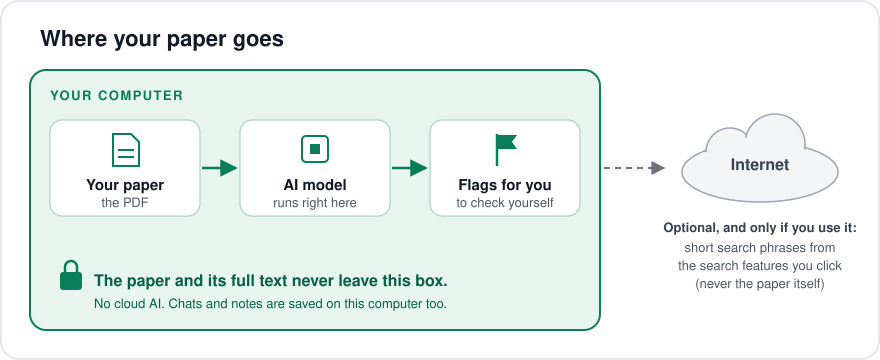
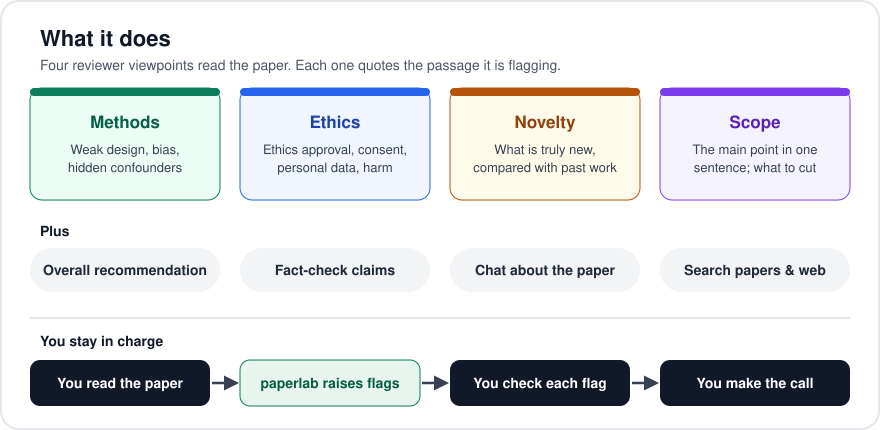
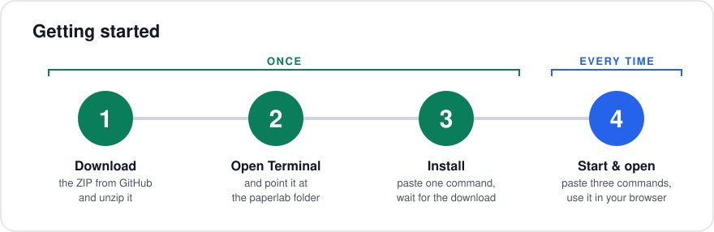

# paperlab.

[](https://doi.org/10.1002/leap.2119)
[-0a7d5a)](https://doi.org/10.1002/leap.2119)


**A private AI helper for reviewing research papers, in any field. It runs entirely on your own laptop, so the paper never leaves your computer.**

> 📄 **Peer-reviewed.** paperlab is the companion tool to *From Policy to Architecture: A Review of Confidential, Human‑Accountable AI Support for Scholarly Peer Review* (Joshi, Joshi, Baisil & Kini), *Learned Publishing* (Wiley), Vol. 40, Issue 1.
> [Read the article →](https://doi.org/10.1002/leap.2119) · [Cite it ↓](#citation)


---

## Why it exists

Journals agree on two rules for AI in peer review: **keep manuscripts confidential**, and **keep a human responsible for the judgment**. paperlab is built so that following those rules is the easy option.





**Good to know**

- **It's a helper, not a reviewer.** Read the paper yourself first. Treat every output as a hint to look closer, never as a verdict.
- **It can be wrong.** It uses a small AI that fits on a laptop. Check everything against the paper.
- **Authors can use it too.** Run it on your own draft to catch weak spots before reviewers do.
- **Follow your journal's AI policy**, and disclose AI help where they ask you to.

---

## What you need

| | |
|---|---|
| 💻 Computer | A Mac or Linux computer. (Windows works through WSL2; ask your IT team to set that up.) |
| 🧠 Memory | 16 GB recommended. On a Mac: Apple menu  → **About This Mac**. |
| 💾 Free space | About 10 GB, for the AI model. |
| 🌐 Internet | Only for the one-time download. After that, it works offline. |

---

## Install (one time)



You'll use **Terminal**, a window where you paste commands. You don't need to understand them: copy each grey box, paste it, and press **Enter**.

**Step 1 · Download.** On this GitHub page, click the green **Code** button → **Download ZIP**. Double-click the ZIP to unzip it.

**Step 2 · Open Terminal in that folder.**
On a Mac, press **⌘ Command + Space**, type `Terminal`, and press **Enter**. Then type `cd ` (with a space after it), drag the unzipped paperlab folder into the Terminal window, and press **Enter**.

**Step 3 · Install.** Paste this and press **Enter**:

```bash
bash setup.sh
```

This downloads the AI model (about 5 GB) and everything else it needs, so it can take a while. If it asks for your computer password, type it and press Enter. **The letters won't appear as you type; that's normal.**

---

## Use it (every time)

Open Terminal in the paperlab folder (Step 2 above), then paste these three lines:

```bash
source .venv/bin/activate
./lab.sh up
python server.py
```

paperlab opens in your web browser. If it doesn't, go to **http://127.0.0.1:8000**. Keep the Terminal window open while you work.

**Then:**

1. **Upload** a PDF (drag it onto the left sidebar).
2. Open the **Review** tab and click **Run all** for the four viewpoints plus an overall recommendation.
3. Use **Brainstorm** to ask questions about the paper. Your chats are saved.

**When you're done,** click the Terminal window, press **Ctrl + C**, then paste:

```bash
./lab.sh down
```

> **Fact-check and Web search** need one extra setup step. See [Optional: web search](#optional-web-search-for-fact-check) below.

---

## Common problems

| What you see | What to do |
|---|---|
| `Permission denied` | Paste `chmod +x lab.sh setup.sh`, press Enter, and try again. |
| "Model not found" | Paste `ollama list` to see installed models, then `ollama pull <name>` (see the `PAPERLAB_MODEL` setting below). |
| Text shows `**` or `#` symbols | Refresh the page with **Ctrl + Shift + R** (Mac: **⌘ + Shift + R**). |
| "Run all" is slow | Normal: it's four full readings of the paper on your laptop. Run one viewpoint at a time instead. |

---

## Privacy, in plain words

The paper, the AI, and all the analysis stay **on your computer**. The only things that go online are short search phrases, and only when you use a search feature: the Web or arXiv tabs, Fact-check, or the related-work lookup in a Novelty review. If you don't use those, nothing about the paper leaves your machine. Your chats and files are saved in a hidden folder called `.paperlab` in your home folder.

---

## For technical users

<details>
<summary><b>Optional: web search for Fact-check</b></summary>

### Optional: web search for Fact-check

Needed only for the **Web** tab and **Fact-check**. Use Podman. It's daemonless, so there's no background service to run at boot.

```bash
sudo apt install -y podman          # or: brew install podman

# config: a real secret_key, the limiter OFF (it 500s otherwise when hit
# directly), and the JSON API ON (off by default, paperlab needs it)
mkdir -p searxng
cat > searxng/settings.yml <<CFG
use_default_settings: true
server:
  secret_key: "$(openssl rand -hex 32)"
  limiter: false
  image_proxy: true
search:
  formats:
    - html
    - json
CFG

podman run -d --name searxng -p 8080:8080 \
  -v "$PWD/searxng:/etc/searxng" \
  docker.io/searxng/searxng

# verify the JSON API actually returns results:
curl -s 'http://localhost:8080/search?q=test&format=json' | head -c 200
```

If `curl` returns JSON, you're set. If it 500s, confirm your config loaded: `podman exec searxng cat /etc/searxng/settings.yml` should show `limiter: false`.

Then start with `./lab.sh up-web` instead of `./lab.sh up`.
</details>

<details>
<summary><b>Requirements, services and startup</b></summary>

- Linux or macOS (Windows via WSL2), Python 3.10+
- `setup.sh` installs Ollama, pulls `qwen3:8b` (~5 GB) and `nomic-embed-text` (~270 MB), creates a virtualenv, and installs `pymupdf4llm`, `requests`, `fastapi`, `uvicorn`, `python-multipart`.
- Optional, only for Web search / Fact-check: **Podman** (preferred) or Docker.
- `server.py` binds to `127.0.0.1` only. `lab.sh` brings services up on demand and leaves them off at boot.

To stop Ollama auto-starting (Podman needs nothing; it has no daemon):

```bash
# Linux
sudo systemctl disable --now ollama
# macOS: System Settings -> Login Items -> remove Ollama
```
</details>

<details>
<summary><b>Features in detail</b></summary>

- **Reviewer personas**: Methodology (confounds, sampling/vantage bias, ground truth, confirmed-vs-suspected), Ethics (IRB, disclosure, harm, PII, consent), Novelty (contribution + delta, grounded in fetched related work), Scoping (one-sentence contribution, what to cut). Each quotes the passage it reacts to.
- **Overall decision**: synthesizes the four critiques into accept / weak accept / weak reject / reject, with a 1–5 score, confidence, and a for/against summary. Treat it as a calibration gut-check, not a program-committee outcome.
- **Fact-check**: claim extraction → web search → supported / contradicted / unclear, with links. Deterministic pipeline; the model only extracts and judges.
- **Sources fetched**: every link pulled during a review is listed with its origin (arXiv / Exa / corpus).
- **Brainstorm chat**: persistent per-paper history under `~/.paperlab/chats`.
- **Corpus search**: embed papers (`nomic-embed-text`) into plain SQLite and search semantically. No vector-DB server.
- **Web (SearXNG)** and **arXiv** search.
- **Rich rendering**: markdown, code, tables, and LaTeX math via KaTeX.
- **Show model thinking**: sidebar toggle; reasoning is hidden by default and stripped from saved context.
</details>

<details>
<summary><b>Command line</b></summary>

```bash
python paperlab.py review paper.pdf [--persona methodology]
python paperlab.py factcheck paper.pdf
python paperlab.py chat paper.pdf
python paperlab.py add related.pdf
python paperlab.py search "ACR fingerprinting"
python paperlab.py web "smart TV data collection"
python paperlab.py arxiv "smart TV ACR privacy"
```
</details>

<details>
<summary><b>Settings (environment variables)</b></summary>

| var | default | purpose |
|---|---|---|
| `PAPERLAB_MODEL` | `gemma4:latest` | reasoning model for stronger critique + vision + 128k context (tighter on RAM) |
| `PAPERLAB_EMBED` | `nomic-embed-text` | embedding model |
| `PAPERLAB_CTX` | `32768` | context window. **Do not lower** or papers get truncated |
| `PAPERLAB_DIR` | `~/.paperlab` | where papers, cache, corpus, and chats live |
| `SEARXNG_URL` | `http://localhost:8080` | your SearXNG instance |
| `EXA_API_KEY` | — | optional semantic search for the Sources panel |
| `OLLAMA_HOST` | `http://localhost:11434` | Ollama endpoint |

On lower-spec machines, try a smaller model.
</details>

<details>
<summary><b>Design notes: from policy to architecture</b></summary>

| Policy principle | How paperlab implements it |
|---|---|
| **Confidentiality** | The model runs locally via Ollama. The PDF and its full text never leave your machine. |
| **Human accountability** | Every output is a flag to look closer, with the quoted passage it reacts to. Nothing is presented as a verdict. |
| **Transparency** | Model reasoning is captured in a toggleable block; every source fetched during a review is listed with its origin. |
| **Minimal, explicit data flow** | The only outbound traffic is short search queries from features you trigger. |
| **Reliability over autonomy** | Python orchestrates a deterministic pipeline; the model only performs narrow, grounded text tasks and never decides what to do next. |

Small models are unreliable at agentic tool-calling, so paperlab never asks the model to decide what to do. Single-paper work loads the whole paper into a 32k context (no RAG; chunking hurts review quality). RAG is used only for cross-paper corpus search.
</details>

<details>
<summary><b>More troubleshooting</b></summary>

- **`404 ... /api/chat` / "Model not found"**: the model isn't pulled. `ollama list`, then `ollama pull <PAPERLAB_MODEL>`.
- **SearXNG 500, log says `X-Forwarded-For nor X-Real-IP`**: the limiter is on. Ensure `settings.yml` has `limiter: false` and is mounted (`podman exec searxng cat /etc/searxng/settings.yml`).
- **Podman `unauthorized: incorrect username or password`**: stale Docker Hub creds. `podman logout --all` and move aside `~/.docker/config.json`.
- **`docker.service` won't start**: use Podman instead; it's daemonless and avoids the containerd dependency.
- **Raw markdown persists after refresh**: check the browser console for a failed CDN load.
</details>

<details>
<summary><b>Files</b></summary>

- `paperlab.py`: core logic + CLI
- `server.py`: FastAPI app (endpoints, streaming)
- `index.html`: the entire UI in one file
- `lab.sh`: on-demand service launcher
- `setup.sh`: installer
- `assets/`: README infographics
</details>

---

## Citation

If paperlab or its design informs your work, please cite:

> Joshi, H., Joshi, U., Baisil, S., & Kini, B. S. (2027). From Policy to Architecture: A Review of Confidential, Human‑Accountable AI Support for Scholarly Peer Review. *Learned Publishing*, 40(1), e2119. https://doi.org/10.1002/leap.2119

```bibtex
@article{joshi2027policy,
  author  = {Joshi, Het and Joshi, Urvish and Baisil, Sharon and Kini, B. Sanjay},
  title   = {From Policy to Architecture: A Review of Confidential,
             Human-Accountable AI Support for Scholarly Peer Review},
  journal = {Learned Publishing},
  year    = {2027},
  volume  = {40},
  number  = {1},
  pages   = {e2119},
  doi     = {10.1002/leap.2119},
  url     = {https://doi.org/10.1002/leap.2119}
}
```

---

**In short:** paperlab makes you faster; it doesn't think for you. Read the paper, form your own view, and let it help you check your work, all without the paper ever leaving your machine.
